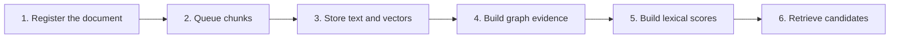

# Schema guide

Source: `rag_sample_schema.sql`. This guide describes the schema defined in that file and the cited repository evidence.

## How data moves

1. **Register the document** — Create or reuse document metadata and record the ingestion run. Tables: `document_details`, `ingestion_runs`, `document_processing_tracker`. Evidence: `application/document_ingestion/main.py:231`, `application/document_ingestion/main.py:274`.
2. **Queue chunks** — Stage each chunk; a worker claims pending rows for processing. Tables: `ingestion_chunk_queue`. Evidence: `application/controller/ingest_controller.py:101`, `application/document_ingestion/worker.py:160`.
3. **Store text and vectors** — Mask chunk text, create an embedding, and store both with the document link. Tables: `document_chunks_vector_table`, `embedding_config`. Evidence: `application/document_ingestion/main.py:8`, `application/document_ingestion/main.py:340`.
4. **Build graph evidence** — Extract triplets and resolve entities and relationships from the original chunk. Tables: `raw_triplet_extractions`, `graph_entities`, `graph_relationships`, `graph_edge_evidence`. Evidence: `application/document_ingestion/main.py:377`, `application/document_ingestion/graph_ingestion.py:341`.
5. **Build lexical scores** — Index masked chunk terms and maintain BM25 statistics and scores. Tables: `chunk_term_frequencies`, `corpus_chunk_stats`, `bm25_scores`. Evidence: `application/document_ingestion/main.py:388`, `application/document_ingestion/bm25_ingestion.py:148`.
6. **Retrieve candidates** — Queries use vector, lexical, and graph stores to find relevant document chunks. Tables: `document_chunks_vector_table`, `bm25_scores`, `graph_relationships`. Evidence: `application/retrieval/vector_retriever.py:47`, `application/retrieval/bm25_retriever.py:69`, `application/retrieval/graph_retriever.py:71`.

## Table areas

### Core / namespace

| Table | Purpose |
| --- | --- |
| `namespace_info` | Tenant/namespace registry — the root scoping unit everything else hangs off of. |
| `user_info` | Users registered within a namespace. |
| `namespace_configurations` | Per-namespace JSON config overrides. |
| `configurations` | Global (non-namespace-scoped) JSON config values. |

### Documents & ingestion

| Table | Purpose |
| --- | --- |
| `document_details` | Canonical document metadata (name, type, source, status, dedup hash). |
| `document_user_groups` | Associates documents with the user groups allowed to access them. |
| `ingestion_runs` | Audit trail per ingest run |
| `document_processing_tracker` | Tracks the status/lifecycle of an ingestion job for a document. |
| `document_deletion_history` | Audit log of document deletion requests/events. |
| `ingestion_chunk_queue` | Queues document chunks for background masking, embedding, graph extraction, and BM25 indexing. |
| `reprocess_policy_tracker` | Tracks policy reprocessing jobs and their resume checkpoints. |
| `document_chunk_token_mapping` | Token map used to unmask a chunk's masked content back to the original. |

### Vector & lexical retrieval

| Table | Purpose |
| --- | --- |
| `document_chunks_vector_table` | Chunk text (masked) plus its embedding vector, for semantic search. |
| `term_frequencies` | Legacy document-level term counts retained in the schema but not populated by current BM25 ingestion. |
| `inverse_document_frequencies` | Legacy document-level inverse-frequency statistics retained in the schema but not populated by current BM25 ingestion. |
| `chunk_term_frequencies` | BM25 lexical index (masked PII tokens only) |
| `corpus_chunk_stats` | Stores per-term and per-namespace chunk statistics used to calculate BM25 scores. |
| `bm25_scores` | Stores precomputed BM25 scores for each chunk and term. |

### GraphRAG

| Table | Purpose |
| --- | --- |
| `raw_triplet_extractions` | Every triplet the LLM extracted from a chunk, unresolved and never deduped — a replayable audit log. |
| `graph_entities` | Canonical, deduped real-world entities in the knowledge graph. |
| `entity_aliases` | Alternate surface forms that resolved to the same canonical entity. |
| `chunk_entity_mentions` | Which chunk each entity mention came from — entity-level provenance. |
| `relationship_types` | Controlled vocabulary of allowed relationship labels. |
| `graph_relationships` | Canonical, deduped edges between two entities. |
| `graph_edge_evidence` | Which chunks support each canonical relationship — edge-level provenance. |
| `graph_communities` | Corpus-level entity clusters/themes with summaries. |
| `graph_community_members` | Which entities belong to which community. |

### LLM provider & model config

| Table | Purpose |
| --- | --- |
| `llm_provider` | Registered LLM providers (e.g. gemini). |
| `provider_attributes` | Per-namespace, per-provider configuration attributes. |
| `model_details` | Specific models offered by a provider (chat/embedding/image). |
| `model_default_attributes` | Default generation parameters (temperature, max_tokens, etc.) per model. |
| `embedding_config` | Records the active and pending embedding models used during model changes. |
| `reprocess_embedding_tracker` | Tracks embedding reprocessing jobs and their backfill and swap phases. |

### Sessions & chat

| Table | Purpose |
| --- | --- |
| `session_info` | Chat session registry per user. |
| `session_level_attributes` | Key/value attributes attached to a session. |
| `session_chat_details` | Individual chat turns (prompt/response, masked and clear) within a session. |
| `chat_images` | Images attached to a chat turn. |
| `chat_level_attributes` | Key/value attributes attached to a single chat turn. |
| `session_token_mapping` | Token map to unmask an entire session's masked content. |

### Chat file uploads

| Table | Purpose |
| --- | --- |
| `file_data_details` | Uploaded file blobs (chat attachments) and their masking/processing status. |
| `session_file_mapping` | Links an uploaded file to a chat session. |
| `file_chunks_details` | Chunked text of an uploaded chat attachment file. |
| `session_file_token_mapping` | Token map to unmask a session-uploaded file's masked content. |

### Connectors & sync (e.g. SharePoint)

| Table | Purpose |
| --- | --- |
| `connector_types` | Catalog of supported external source-connector types. |
| `connector_config` | A configured instance of a connector for a namespace. |
| `source_repositories` | External repositories discovered/registered via a connector. |
| `sync_jobs` | A single run of the connector sync process. |
| `monitored_folders` | Folders within a source repository being watched for sync. |
| `source_file_inventory` | Inventory of files discovered in a monitored folder, with sync/dedup metadata. |
| `sync_folder_status_tracking` | Per-folder progress/counts for a sync job. |
| `sync_file_status_tracking` | Per-file progress/status for a sync job. |

### Audit & PII

| Table | Purpose |
| --- | --- |
| `audit_request_history` | Generic audit trail of request-scoped field values. |
| `request_pii_details_history` | Count of PII types detected per request/chat. |

For columns, keys, relationship direction, and source links, open `/home/ganapati/Documents/ML/RAG/qa-rag-systems/docs/schema-map-pilot.html`.
