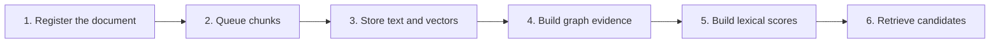

# Schema guide

Source: `rag\_sample\_schema.sql`. This guide describes the schema defined in that file and the cited repository evidence.

## How data moves

1. **Register the document** — Create or reuse document metadata and record the ingestion run. Tables: `document\_details`, `ingestion\_runs`, `document\_processing\_tracker`. Evidence: `application/document\_ingestion/main.py:231`, `application/document\_ingestion/main.py:274`.
2. **Queue chunks** — Stage each chunk; a worker claims pending rows for processing. Tables: `ingestion\_chunk\_queue`. Evidence: `application/controller/ingest\_controller.py:101`, `application/document\_ingestion/worker.py:160`.
3. **Store text and vectors** — Mask chunk text, create an embedding, and store both with the document link. Tables: `document\_chunks\_vector\_table`, `embedding\_config`. Evidence: `application/document\_ingestion/main.py:8`, `application/document\_ingestion/main.py:340`.
4. **Build graph evidence** — Extract triplets and resolve entities and relationships from the original chunk. Tables: `raw\_triplet\_extractions`, `graph\_entities`, `graph\_relationships`, `graph\_edge\_evidence`. Evidence: `application/document\_ingestion/main.py:377`, `application/document\_ingestion/graph\_ingestion.py:341`.
5. **Build lexical scores** — Index masked chunk terms and maintain BM25 statistics and scores. Tables: `chunk\_term\_frequencies`, `corpus\_chunk\_stats`, `bm25\_scores`. Evidence: `application/document\_ingestion/main.py:388`, `application/document\_ingestion/bm25\_ingestion.py:148`.
6. **Retrieve candidates** — Queries use vector, lexical, and graph stores to find relevant document chunks. Tables: `document\_chunks\_vector\_table`, `bm25\_scores`, `graph\_relationships`. Evidence: `application/retrieval/vector\_retriever.py:47`, `application/retrieval/bm25\_retriever.py:69`, `application/retrieval/graph\_retriever.py:71`.

## Table areas

### Core / namespace

| Table | Purpose |
| --- | --- |
| `namespace\_info` | Tenant/namespace registry — the root scoping unit everything else hangs off of. |
| `user\_info` | Users registered within a namespace. |
| `namespace\_configurations` | Per-namespace JSON config overrides. |
| `configurations` | Global \(non-namespace-scoped\) JSON config values. |

### Documents &amp; ingestion

| Table | Purpose |
| --- | --- |
| `document\_details` | Canonical document metadata \(name, type, source, status, dedup hash\). |
| `document\_user\_groups` | Associates documents with the user groups allowed to access them. |
| `ingestion\_runs` | Audit trail per ingest run |
| `document\_processing\_tracker` | Tracks the status/lifecycle of an ingestion job for a document. |
| `document\_deletion\_history` | Audit log of document deletion requests/events. |
| `ingestion\_chunk\_queue` | Queues document chunks for background masking, embedding, graph extraction, and BM25 indexing. |
| `reprocess\_policy\_tracker` | Tracks policy reprocessing jobs and their resume checkpoints. |
| `document\_chunk\_token\_mapping` | Token map used to unmask a chunk's masked content back to the original. |

### Vector &amp; lexical retrieval

| Table | Purpose |
| --- | --- |
| `document\_chunks\_vector\_table` | Chunk text \(masked\) plus its embedding vector, for semantic search. |
| `term\_frequencies` | Legacy document-level term counts retained in the schema but not populated by current BM25 ingestion. |
| `inverse\_document\_frequencies` | Legacy document-level inverse-frequency statistics retained in the schema but not populated by current BM25 ingestion. |
| `chunk\_term\_frequencies` | BM25 lexical index \(masked PII tokens only\) |
| `corpus\_chunk\_stats` | Stores per-term and per-namespace chunk statistics used to calculate BM25 scores. |
| `bm25\_scores` | Stores precomputed BM25 scores for each chunk and term. |

### GraphRAG

| Table | Purpose |
| --- | --- |
| `raw\_triplet\_extractions` | Every triplet the LLM extracted from a chunk, unresolved and never deduped — a replayable audit log. |
| `graph\_entities` | Canonical, deduped real-world entities in the knowledge graph. |
| `entity\_aliases` | Alternate surface forms that resolved to the same canonical entity. |
| `chunk\_entity\_mentions` | Which chunk each entity mention came from — entity-level provenance. |
| `relationship\_types` | Controlled vocabulary of allowed relationship labels. |
| `graph\_relationships` | Canonical, deduped edges between two entities. |
| `graph\_edge\_evidence` | Which chunks support each canonical relationship — edge-level provenance. |
| `graph\_communities` | Corpus-level entity clusters/themes with summaries. |
| `graph\_community\_members` | Which entities belong to which community. |

### LLM provider &amp; model config

| Table | Purpose |
| --- | --- |
| `llm\_provider` | Registered LLM providers \(e.g. gemini\). |
| `provider\_attributes` | Per-namespace, per-provider configuration attributes. |
| `model\_details` | Specific models offered by a provider \(chat/embedding/image\). |
| `model\_default\_attributes` | Default generation parameters \(temperature, max\_tokens, etc.\) per model. |
| `embedding\_config` | Records the active and pending embedding models used during model changes. |
| `reprocess\_embedding\_tracker` | Tracks embedding reprocessing jobs and their backfill and swap phases. |

### Sessions &amp; chat

| Table | Purpose |
| --- | --- |
| `session\_info` | Chat session registry per user. |
| `session\_level\_attributes` | Key/value attributes attached to a session. |
| `session\_chat\_details` | Individual chat turns \(prompt/response, masked and clear\) within a session. |
| `chat\_images` | Images attached to a chat turn. |
| `chat\_level\_attributes` | Key/value attributes attached to a single chat turn. |
| `session\_token\_mapping` | Token map to unmask an entire session's masked content. |

### Chat file uploads

| Table | Purpose |
| --- | --- |
| `file\_data\_details` | Uploaded file blobs \(chat attachments\) and their masking/processing status. |
| `session\_file\_mapping` | Links an uploaded file to a chat session. |
| `file\_chunks\_details` | Chunked text of an uploaded chat attachment file. |
| `session\_file\_token\_mapping` | Token map to unmask a session-uploaded file's masked content. |

### Connectors &amp; sync \(e.g. SharePoint\)

| Table | Purpose |
| --- | --- |
| `connector\_types` | Catalog of supported external source-connector types. |
| `connector\_config` | A configured instance of a connector for a namespace. |
| `source\_repositories` | External repositories discovered/registered via a connector. |
| `sync\_jobs` | A single run of the connector sync process. |
| `monitored\_folders` | Folders within a source repository being watched for sync. |
| `source\_file\_inventory` | Inventory of files discovered in a monitored folder, with sync/dedup metadata. |
| `sync\_folder\_status\_tracking` | Per-folder progress/counts for a sync job. |
| `sync\_file\_status\_tracking` | Per-file progress/status for a sync job. |

### Audit &amp; PII

| Table | Purpose |
| --- | --- |
| `audit\_request\_history` | Generic audit trail of request-scoped field values. |
| `request\_pii\_details\_history` | Count of PII types detected per request/chat. |

For columns, keys, relationship direction, and source links, open `schema-map-pilot.html`.
